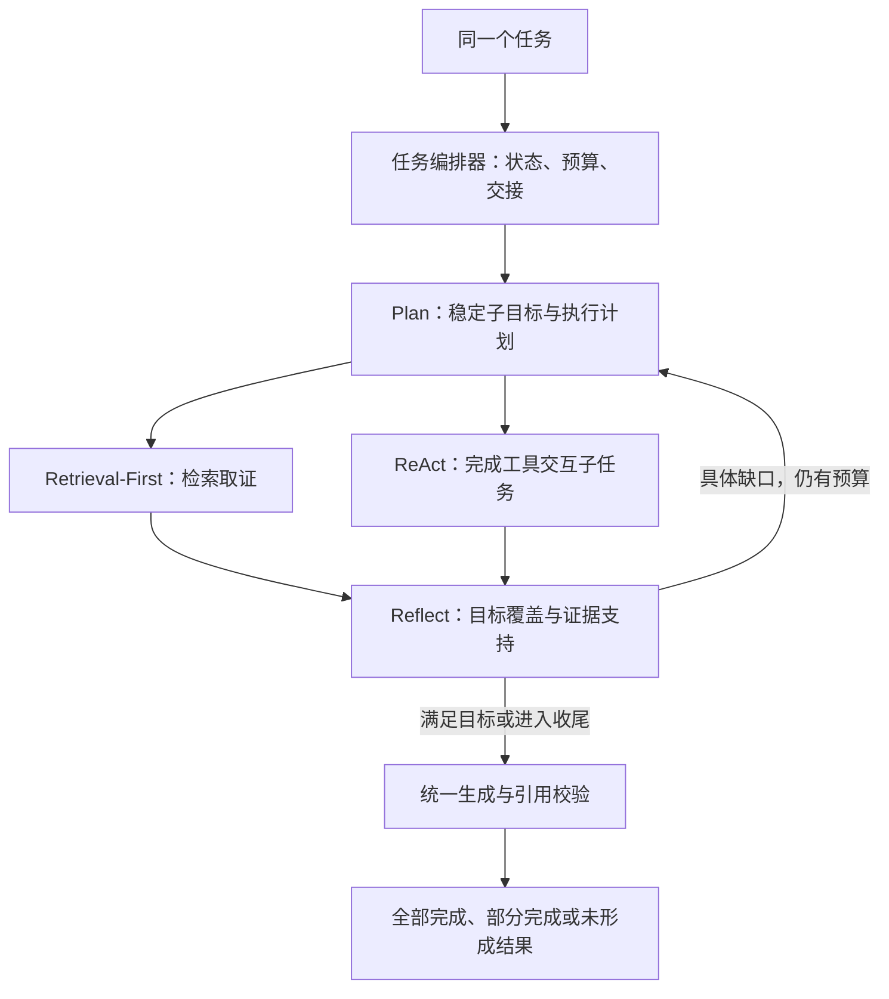

# 多范式协同分析第一版设计

日期：2026-10-20。状态：已确认的协同执行技术稿；当前线上仍按会话模式选择一种执行引擎。用户已要求开始开发，见 [科研与阅读平台第一版设计](research-reading-platform-v1-design.md)。

实现说明：本次使用独立 `reading` 业务模块和新任务接口承载跨范式阶段，保留旧 AgentMode 和聊天协议。下文关于第四种模式及旧执行器扩展的内容属于原候选方案，未作为本次接口合同实现；实际代码、迁移和阶段适配边界见 [实现说明](reading-v1-implementation.md)。

## 已确定的产品约束

- 第一版聚焦同一知识库内用户选定资料的阅读与多步分析，使用已有的检索、片段上下文和文档信息工具；所有候选获取与工具读取均执行明确的文档白名单。
- 同一任务内允许 Retrieval-First、ReAct、Plan-Execute-Reflect 按需要接力。
- 有依据的部分可以交付，明确展示未解决目标与原因，区分“全部完成”和“部分完成”。
- 单轮协同分析的总预算为 180 秒；证据和目标齐全时提前结束。
- 接力围绕具体子目标，继承已验证证据、依赖结果和剩余预算。

## 建议的控制结构

阅读流程默认自动调度，暂定协议值 COORDINATED；它表示编排方式，阶段引擎仍是已有三种范式。原三种独立模式保留兼容性和回归基线用途。

第一版根据阅读目标选择简单或复杂路径：简单定位使用 Retrieval-First，复杂任务进入规划，再按需要委派取证和 ReAct 子任务。复杂任务直接规划；满足目标即可结束。路径判断仍受资料范围、预算和目标覆盖的统一约束。

Plan 委派子任务；ReAct 可调用受控检索工具取证。子阶段向上返回产物和缺口，由上层安排重规划。只有编排器发布整个任务的最终完成事件。

## 示例与完成条件

首个样例任务：“围绕《脂砚斋评石头记》中‘风月宝鉴’相关内容，梳理情节与评点，区分原文事实、评点观点和系统推论，生成带引用的阅读笔记。”这是设计验收场景，具体分析结论由选定版本的真实原文决定。

| 子目标 | 执行方式 | 完成条件 |
| --- | --- | --- |
| 找到主题相关的行为与情节 | Retrieval-First | 找到属于选定文档的可核验原文 |
| 找到相关评点及其正文关联 | Retrieval-First | 找到对应原文；归属不明时记录缺口 |
| 核实前后文是否支持拟采用的解释 | ReAct | 围绕已有来源读取上下文，返回有证据支持的子结论或缺口 |
| 检查事实、评点、推论与引用 | Reflect | 每个必需目标都有可追溯的支持，或列出未覆盖项 |

允许针对真实缺口补查。测试需要同时覆盖直接完成和实际发生重规划的路径；每个任务按实际需要调用阶段引擎。

## 子任务与阶段交接协议

建议新增独立的 CoordinationPlan / CoordinationStep，复用现有计划校验能力，保持原 PlanAction 的兼容性。每个子任务包括：

- 稳定的 goalId、执行用的 stepId、计划版本、目标描述和完成条件。
- 执行引擎 RETRIEVAL_FIRST 或 REACT、依赖的阶段产物引用。
- 允许使用的能力、剩余预算、知识库及选定文档边界。

用户要求的必需目标在首次规划后冻结。重规划可以调整步骤和查询，不能通过删除未满足的用户目标获得“全部完成”。

StageResult 建议包含：

- outcome：COMPLETED / NEEDS_EVIDENCE / BLOCKED / FAILED / CANCELLED。
- 已验证的子结论及其 evidenceRefs；原始模型草稿不属于已验证结果。
- completedGoalIds、gaps（关联 goalId、缺口类型、具体需要的证据）。
- 安全的工具执行摘要，以及模型、工具和时间消耗。

阶段完成、步骤执行成功和整个任务全部完成分别判定。阶段日志用于追踪，交接依赖结构化产物。

## 共享状态与引用

RootTaskState 统一持有 executionId、知识库与选定文档版本、会话边界、原始目标、计划版本、证据登记、阶段结果、预算和取消信号。每个阶段取得受限子上下文。

现有 AgentExecutionContext 与请求实例和单一模式绑定，并防止上下文二次认领；需要增加子阶段接口，继承根任务边界和截止时间。阶段事件关联根任务，同时标明实际引擎、子目标和阶段标识。

EvidenceRef 至少包含 knowledgeBaseId、documentId、资料与解析版本、chunkId、原文内容哈希、选中摘录范围和有界摘录快照。持久化有界的子结论及其证据绑定，正文按需从原库重读；历史结果仍保留当时的摘录和版本信息。引用编号由根任务统一分配，模型生成的摘要不会作为新的原文证据。

恢复时复核来源和输入指纹。原文或依赖产物发生变化时，只复用仍有效的结果，并重新处理受影响的目标。

## 反思：硬校验与语义检查

采用两层检查，复用已有引用和来源校验：

1. 代码检查知识库与文档归属、来源哈希、引用绑定、步骤依赖和预算。
2. 模型读取有界的目标、子结论与原文，判断每个必需目标是否被证据支持，返回结构化覆盖报告与具体缺口。

模型覆盖报告不能覆盖代码校验失败。未能完成语义检查的目标记录为未确认；已有核验通过的其他结果仍可交付。仅“检索到了片段”或“步骤执行成功”不足以认定目标已满足。

重规划输入限定为目标和明确缺口。服务超时、鉴权失败、取消等执行事件进入对应错误处理，不通过反复切换范式处理。

## 预算与收尾

180 秒、8 次生成请求、12 次工具调用和一次重规划上限已确定。收尾时间及单次超时为工程初始建议，通过配置和验收校准：

| 项目 | 首版规则与工程初始值 |
| --- | --- |
| 整体执行预算 | 180 秒 |
| 最晚进入收尾 | 第 140 秒，为最终生成和校验预留 40 秒 |
| 单次模型 / 工具调用上限 | 35 秒，并受所在阶段及根任务剩余时间约束 |
| 根任务聊天模型请求上限 | 8 次，包含规划、ReAct、反思、修复、重试和最终生成 |
| 根任务工具调用上限 | 12 次，按受控工具操作统一计数，阶段包装不重复计数 |
| 重规划上限 | 1 次 |
| 执行方式 | 同时运行一个长任务，其余持久化排队；任务内部首版串行 |

阶段交接保留累计消耗。聊天请求在发往提供方前扣减额度；客户端内部重试也要纳入计数，必要时由编排器统一执行重试。Embedding、重排及检索通道使用各自有界请求与重试配置，另记录实际调用量。外层调用和内部检索使用一致的截止时间，避免外层过早取消。模型输入继续遵守有界证据窗口和上下文限制。

编排器为收尾保留调用额度。剩余预算不足以安全发起一次模型请求时，使用已核验子结论的结构化展示交付部分结果。达到截止时间后停止发起模型和工具调用；已经持久化的可靠产物仍可读取。

## 完成度与界面

执行状态继续描述排队、运行、暂停、成功、失败和取消；交付完成度单独记录为 FULL / PARTIAL / NONE。旧任务没有目标覆盖评估时，保持原有“已完成”等展示语义，不补造完整度结论。

- FULL：全部必需目标有可靠支撑，交付结果的每个结论通过证据和引用检查。
- PARTIAL：至少一个可交付子目标已验证，其余目标和缺口明确列出。
- NONE：没有形成可交付的可靠子结论；仅存在检索命中不构成部分完成。

界面展示“已完成的分析”“尚未解决的问题”“缺口原因”，时间线可查看实际执行范式。部分结果提供“继续补全”；继续补全沿用同一个任务 ID，创建独立尝试，并保留之前的结果版本。

运行故障与完成度分别呈现。补全失败时，之前已经交付的结果仍然可见。前端新增入口、完成度与缺口展示遵守 DESIGN.md。

## 检查点与持久化

当前 result_json 用作最终结果安全检查点，恢复器发现它存在就直接完成任务；步骤和工具摘要不能完整重建阶段证据。协同设计需要区分：

- 协同执行检查点：尝试标识、绝对截止时间、已用预算、目标、计划、阶段产物及当前位置。
- 已交付结果版本：答案、完成度、目标覆盖、缺口及引用。

建议新增专用协同检查点和结果版本存储，复用现有任务 ID、租约、runToken、乐观锁与审计表。完成阶段时，阶段产物与阶段状态在同一事务内提交，再发送进度事件。重启恢复从有效检查点继续，同次尝试不重置预算。

用户主动“继续补全”时开启新一轮最多 180 秒的尝试，保留原必需目标，明确记录新一轮消耗并复用有效产物。异常中断则进入待恢复状态，由用户手动恢复，沿用原轮计数及截止时间；到期后先整理已有可靠成果，后续计算由用户主动开启补全轮。现有 result_json 非空即跳过执行的逻辑需要为协同路径适配，已交付版本独立保留。

新问题在同一阅读会话下创建关联任务并建立新目标；相关证据核验后复用。阅读笔记独立保存，用户可编辑；AI 更新产出新版草稿，采纳前保留当前笔记与历史修订。资料更新时重新核验受影响证据与阶段，旧笔记标明所依据版本。

任务列表继续分页并使用摘要投影，完成度过滤通过可索引的摘要字段实现，避免读取完整结果 JSON。

## 当前代码的主要改造位置

| 现有模块 | 建议改造 |
| --- | --- |
| AgentRouter / AgentMode | 注册协同入口；原三种独立实现保留 |
| AgentExecutionContext / AgentCheckpointSink | 增加子阶段上下文、根预算和阶段产物检查点 |
| Plan / Planner / PlanValidator | 增加面向子目标的协同计划与执行引擎选择，复用依赖和循环校验 |
| RagQueryRetrievalService / RetrievalFirstAgent | 抽出取证阶段，协同子任务不重复生成整个问题的答案 |
| ReActAgent / ToolExecutionContext | 复用有界循环和工具注册表，支持子目标及共享证据登记 |
| Reflector / EvidenceCoverageVerifier | 有界的目标覆盖与证据支持检查，输出可执行缺口 |
| ExecutionRunner / ExecutionStore | 区分执行检查点和已交付版本，支持部分结果继续补全 |
| ExecutionResponse / 进度协议 / 前端任务页 | 扩展完成度、覆盖报告、阶段引擎与继续补全 |
| Flyway | 新增迁移，扩展模式白名单及检查点/结果版本结构，保留既有迁移文件 |

## 实现与验收顺序

1. 子目标、StageResult、根任务状态及共享预算；测试交接、来源绑定和预算累计。
2. 取证与 ReAct 阶段适配、编排器及有界反思；使用脚本模型覆盖完整、部分、无结果和一次重规划。
3. 数据迁移、阶段检查点、租约与恢复、结果版本和继续补全；验证取消、过期工作线程、来源变化及重启恢复。
4. 按 DESIGN.md 接入界面和时间线，完成真实知识库验收及旧三种模式回归。

首版必须验证：同一任务 ID 下真实发生跨范式交接；子结论的引用可回到原文；重规划只补明确缺口；预算结束能交付已有可靠部分；补全失败保留旧结果；进程恢复不会重复认领或丢失已提交产物。现有知识库和文档正文保持原样。
